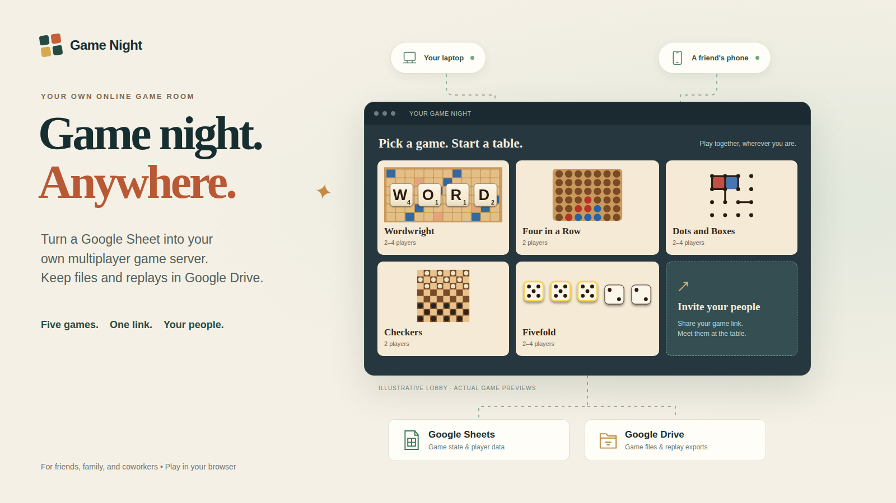

# Game Night v0.1.0

A multiplayer kit you install in your own Google Sheet and bound Apps Script project. Play Wordwright, Four in a Row, Dots and Boxes, Checkers, Fivefold, and Tic-tac-toe together in your browsers.

## Download and install

1. Get **game-night-v0.1.0.zip** from the [v0.1.0 GitHub Release](https://github.com/tweakyourpc/game-night/releases/tag/v0.1.0). Choose the installation ZIP under Assets; GitHub's automatic source-code archives are for development.
2. Follow the [browser-only installation guide](docs/install.md). A desktop browser and text editor are enough. No clasp, Node, Python, terminal, or hosted asset service is required. Paste the supplied files into Google's editor; Apps Script does not import this ZIP. **No public spreadsheet template is currently provided.**
3. Work through the [operator checklist](docs/operator-checklist.md) and [Google acceptance checklist](docs/google-acceptance.md) before regular use. This is a locally verified release candidate, **not production-ready**; real Google deployment testing remains required. See [known limitations](#limits).

[Clasp](docs/clasp.md) and [local development](#optional-local-development) are optional developer workflows.

## Choose the account that runs Game Night

We recommend a separate Google account to keep Game Night mail, Drive files, and service authorizations separate from your personal or everyday work activity. **This is optional.** The account that deploys the web app sends invitations and reminders through MailApp and owns the installation's `Game Night files` Drive folder. The game spreadsheet contains the game data; players use the web-app link and do not need spreadsheet access. Use the same account for setup, deployment, and optional repair triggers.

Personal and organization-managed Google accounts can be used. Google Workspace administrators may restrict public web apps or service authorization. Google mail delegation, aliases, and shared mailboxes are outside this kit and must be configured separately if desired. Choosing a dedicated account does not change player authentication; see [identity and access](docs/identity.md).

## Implemented

- Wordwright (2-4), Four in a Row (2), Dots and Boxes (2-4), Checkers (2), Fivefold (2-4), and Tic-tac-toe (2).
- Wordwright supports local rack sorting, resignation, and normal score tally after six scoreless turns. The separate Abandon match control ends a match without a winner.
- Persistent tables, seats/readiness, host transfer, rematches, invitations, optional turn email, and pasted Meet links.
- Walnut Parlor and Slate Study themes, synthesized sound, keyboard/touch controls, procedural boards and four optional Wordwright board pictures.
- Server-authoritative moves, revision checks, retry identifiers, repairable follow-ups, session hashes and admin PINs.
- Public-event replay playback and JSON download; conditional real-time browser video recording; admin Drive saves.

## Limits

This is a locally verified release candidate, **not production-ready**. Google authorization, quotas, iframe behavior, copied-sheet deployment, mail and Drive permissions still require the [acceptance checklist](docs/google-acceptance.md). There is no Google account authentication for players. Trusted mode allows anyone with the shared code to choose any ordinary member's name. See [identity and access](docs/identity.md).

No automatic Meet creation, universal MP4 export, WebCodecs encoder, cloud synchronization service, or public spreadsheet template is implemented. Recording requires a visible tab and compatible browser APIs/codec/canvas security; JSON export remains independent. Storage uses Sheets cells, including match action history, so sufficiently long games can reach Google's cell limit. There is no automatic archival or data migration from a live Crabbles instance.

The Maple, Walnut, Felt and Slate images were carried over from the supplied project. Their known origin and unresolved rights are recorded in [licences](docs/licenses.md); inclusion is not a claim of legal clearance.

## Guides

[Setup](docs/install.md) · [Operator checklist](docs/operator-checklist.md) · [Google acceptance](docs/google-acceptance.md) · [Optional clasp](docs/clasp.md) · [Troubleshooting](docs/troubleshooting.md) · [Identity](docs/identity.md) · [Games](docs/game-authoring.md) · [Themes](docs/theme-authoring.md) · [Replay v1](docs/replay-format.md) · [Upgrade/backup](docs/upgrading.md) · [Licences](docs/licenses.md) · [Verification](docs/verification.md)

## Optional local development

Node 20+ runs `npm test` and `npm run build` (ZIP and unzip utilities also required). `dist/apps-script` is generated; edit `src` instead. Browser/PDF checks additionally need Playwright and Chrome. Board regeneration and the optional EffectCraft converter need Python 3 and Pillow; EffectCraft rendering also needs `effectcraft-cli`. None of these are installation requirements.

For a local preview, allocate a port first: `PORT=$(portbroker alloc --name game-night-dev)` then `node tools/dev_server.js --port "$PORT"`. It binds to LAN and uses synthetic demo accounts only. Without `--words <ENABLE-file>` its test dictionary accepts all words. Never use that harness as the Google deployment.
